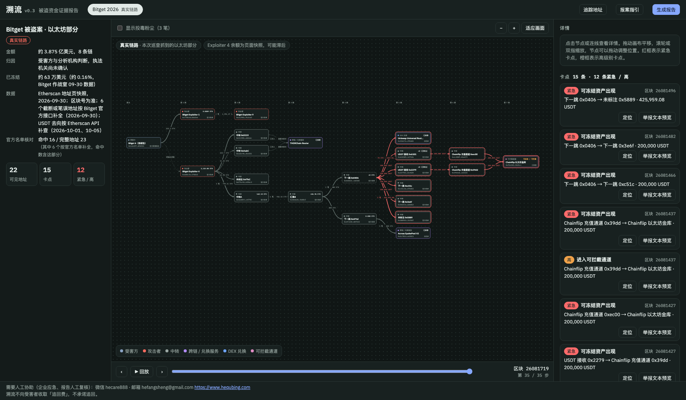
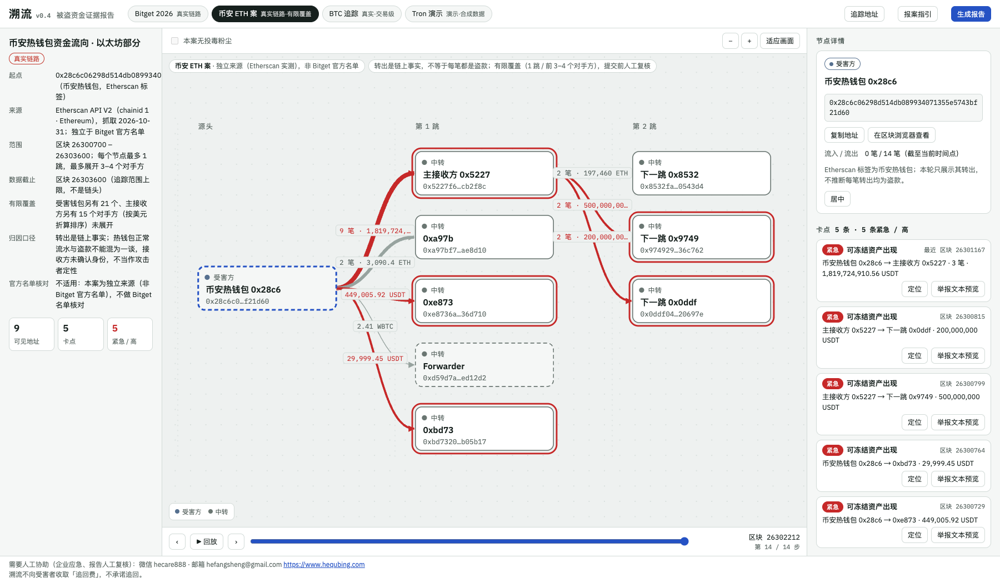
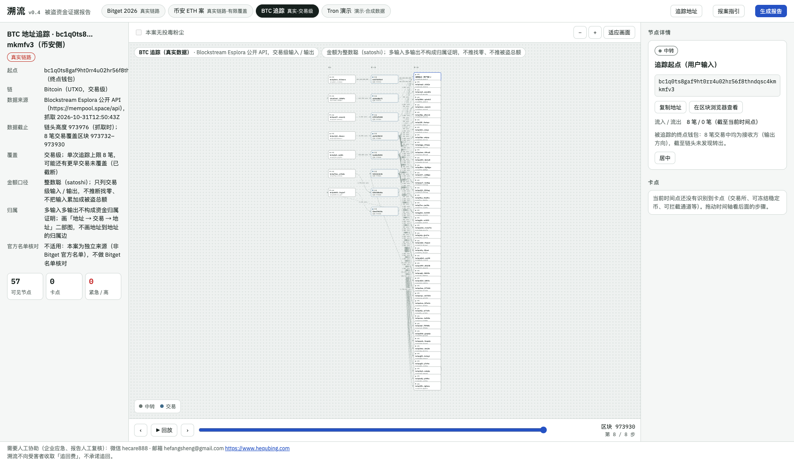
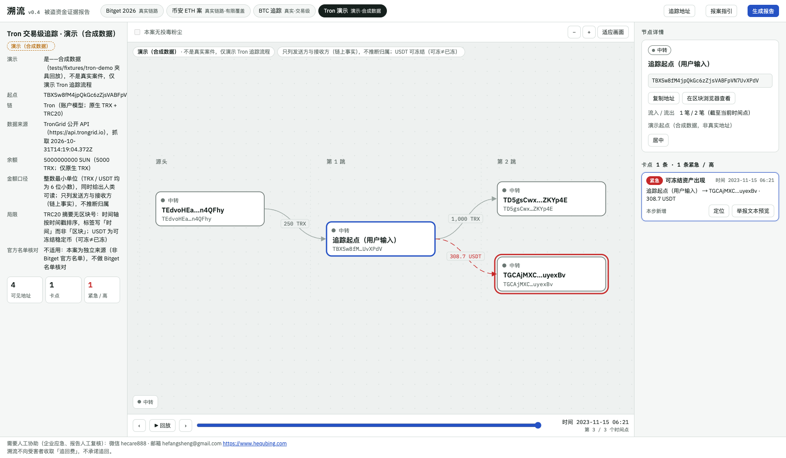

# 溯流（Suliu）v0.4

**钱被盗之后，把一个钱包地址变成一份能直接拿去报案、找交易所冻结的证据报告。**

> Turn one stolen-funds wallet address into an evidence report you can hand to the police or send to an exchange to request a freeze.

[](LICENSE)
[]()
[]()
[]()
[]()

<p align="center"></p>

开源、免安装、免费：一个 HTML 文件加几个脚本，双击就能用。溯流只把公开链上数据变成你自己拿去用的报告：**不常驻盯盘，不经手资金，不替你联系任何人，不承诺追回。**

在线版：https://dongsheng123132.github.io/suliu/ （国内打开慢，也可本地双击 `溯流资金画布.html`）

## 目录

- [三步用法](#三步用法)
- [内置案例（资金地图）](#内置案例资金地图)
- [报告里有什么](#报告里有什么)
- [能做什么，不能做什么](#能做什么不能做什么)
- [命令行](#命令行开发与人工应急服务用)
- [合规声明](#合规声明)
- [目录结构](#目录)
- [许可](#许可)
- [English](#english)

## 三步用法

1. **双击打开** `溯流资金画布.html`（用浏览器打开，不用安装任何东西）。
2. **填你自己的 Etherscan key**：点右上角「追踪地址」，粘贴 key。没有的话到 https://etherscan.io/myapikey 免费申请。key 只存在你自己的浏览器里，只发给 Etherscan，不会写进报告、不会导出、不会上传到别处。
3. **输入被盗地址追踪，生成报告，打印成 PDF**：填被盗的以太坊地址（知道被盗时间的话填起始区块，可以少花调用次数），点「开始追踪」；追完点「生成报告」，在新窗口里按 Ctrl+P（Mac 为 ⌘P）另存为 PDF。

目标是被盗的人 10 分钟内拿到一份可以打印的报告。想先看成品：打开 `docs/示例报告-Bitget.html`（Bitget 案的真实链路）。

## 内置案例（资金地图）

顶栏标签可切换，默认 Bitget；每个案例沿用同一套三栏画布（节点连线、时间轴回放、拖放缩放、点节点 / 连线看证据、导出、生成报告）。

| Bitget（默认，真实） | 币安 ETH 案（真实·有限覆盖） |
| --- | --- |
|  |  |

| BTC 追踪（真实·二部图） | Tron 演示（合成数据） |
| --- | --- |
|  |  |

- **Bitget 被盗案**（默认）：真实链路示例；「官方名单核对」只对本案启用（Bitget 静态官方名单）。
- **币安 ETH 案**（2026-10-31 新增）：用 **Etherscan API V2 独立实测**（chainid 1），**不是** Bitget 官方名单。只追了 **1 跳、前 3–4 个对手方**，数据截止 **区块 26303600**（范围 26300700–26303600，不是链头）；受害钱包另有 21 个、主接收方另有 15 个对手方未展开（**有限覆盖**）。**转出是链上事实，热钱包的正常流水与盗款不能混为一谈；接收方未确认身份，不当作攻击者定性**。
- **BTC 追踪**：币安侧真实数据，画「地址 → 交易 → 地址」**二部图**（交易本身是节点）；**不画地址到地址的归属边**、不推找零、不把输入累加成被盗总额；金额整数聪。
- **Tron 演示**：**合成演示数据**（`tests/fixtures/tron-demo` 回放），不是真实案件，仅演示 Tron 追踪流程；USDT 标「可冻结 ≠ 已冻结」。

币安 / BTC / Tron 案例的链接按链生成（ETH→Etherscan、BTC→mempool.space、Tron→tronscan），时间轴区分「区块 / 时间」。

## 报告里有什么

| 节 | 内容 |
| --- | --- |
| 1 封面信息 | 案件、报告编号、生成时间、数据来源、数据截止区块与时间；你自愿填写的报案人 / 联系方式 / 被盗经过（只写进报告文件，不保存、不上传） |
| 2 摘要 | 起点、追踪范围、规模、卡点数量、金额最大的前 3 个卡点、截断提示、待核实事项 |
| 3 资金去向图 | 缩放友好的矢量图，红框 / 橙框标出紧急与高级别卡点 |
| 4 卡点清单 | 交易所、可冻结稳定币、可拦截通道（如 Chainflip）、跨链 / 兑换、混币器；每个卡点写明该找谁、怎么说、要带什么，并标明是「链上事实」还是「推断」 |
| 5 交易明细 | 每笔的时间（UTC+8）、区块、金额、交易哈希和区块浏览器链接 |
| 6 地址清单 | 完整地址、类型、判断依据、官方名单核对结果（仅 Bitget 案） |
| 7 方法与局限 | 数据来源、过滤规则、被忽略的记录、追踪停止点与下一步 |
| 8 免责声明 | 不是法律意见、不承诺追回、归因分级 |
| 9 附录：报案指引 | 报案材料清单、给交易所 / 协议方的冻结与保全请求模板（中英文，空格留出手写位置） |

## 能做什么，不能做什么

能做（2026-10-31 扩展，命令行为最小可用版本）：

- 追踪 **以太坊主网 / BNB Smart Chain** 上从一个地址转出的资金，最多 5 跳；API 调用有上限，用多少显示多少。**每条链用自己的原生币与代币白名单**，不会把 ETH 的配置套到 BSC 上；未知链直接拒绝。
- **BTC 公开 UTXO 追踪**（命令行）：用公开 Esplora API（mempool.space 实例），**不需要 key**；只做**交易级**输入 / 输出与确认状态，金额一律整数 satoshi。不声称某个输入支付了某个输出、不推断找零归属、不把输入金额累加成被盗总额。
- **Tron 公开交易追踪**（命令行）：用公开 **TronGrid API**（`https://api.trongrid.io`），**不需要 key**；查原生 TRX、TRC20 与账户余额。地址严格做 **base58check 校验和**（双 SHA-256），篡改过的地址直接报错、不拼链接。只做**交易级**：不推断地址归属、不推断资金归属。USDT 只认官方合约 `TR7NHqjeKQxGTCi8q8ZY4pL8otSzgjLj6t`（6 位小数），其它 TRC20 合约一律按非白名单**只计数、不展开**。
- 代币真假只按**该链的合约地址**判断（ETH：USDT / USDC / DAI / WETH / WBTC / stETH + 原生 ETH；BSC：Binance-Peg 的 USDT / USDC / WBNB / ETH / BTCB / BUSD + 原生 BNB）；假币、0 值、粉尘、首尾相同的仿冒地址只计数、不展开。
- 识别可冻结点：交易所、可冻结稳定币、可拦截通道，并写明下一步。
- **跨链解析（Across 官方 API）**：按 `originChainId + depositId`（或源交易哈希）查询 `/deposit/status` 与 `/deposit`，保留原始响应、请求来源与查询时刻；`filled / pending / refunded / expired / not_found / unknown` 分开显示，**退款不当作完成**。**Chainflip 本轮明确 unsupported**，只给官方浏览器人工链接，不假装已自动解析。
- 把追踪结果导出为 JSON；BTC / Tron / 跨链结果可生成**可打印 HTML 报告**（多链报告生成器）。
- 无 key 演示：仓库带**合成的夹具回放**（`tests/fixtures/btc-demo/`、`tests/fixtures/tron-demo/`、`tests/fixtures/across-demo/`），报告里会明确标注「演示数据（夹具回放）：合成的演示数据，不是真实案件」。

不能做：

- **不做 Solana 等其它链。** 非 EVM 链目前做了 BTC（UTXO）与 Tron（账户模型）的交易级追踪；其它链以后再说。
- **Tron 只到交易级。** 原生 TRX 只取 `TransferContract`，不含智能合约内部转账；TRC20 摘要只给时间戳、不带区块号。USDT 是「可冻结稳定币」，但**可冻结 ≠ 已冻结**，本工具不查询、也不断言任何实际冻结状态。
- **BTC 不构成资金归属证明。** 多输入多输出交易里，不推断哪个输入支付了哪个输出、不推断找零归谁、不累加输入为被盗总额。
- **跨链只认已核实的官方 API。** 不凭「同金额、同时间」猜跨链对应；Chainflip 没有稳定公开 API，只给人工链接。
- **只追转出。** 转入和退款（例如协议把资金退回）没有纳入，报告里会写明。
- **自动结果需要人工复核。** 可能漏判或误判；提交任何材料前请逐位核对地址与哈希。
- **不实时盯盘，不发提醒。** 追的是你点击或运行命令那一刻的链上数据。
- 不代提交举报、不发邮件、不联系任何机构，所有对外动作由你自己确认后做。

## 命令行（开发与人工应急服务用）

需要 Node.js 24。Etherscan 的 key 放在环境变量 `ETHERSCAN_API_KEY`，或复制 `.env.example` 为 `.env` 后填入（`.env` 已在 `.gitignore` 里）。BTC 不需要 key；Across 可选 `ACROSS_API_KEY`（没有就走夹具回放）。

```bash
# 以太坊（默认）与 BSC：--chain eth / bsc
node tools/trace.mjs <地址> --chain eth --from-block N --hops 3 --top 5 --max-calls 80
node tools/trace.mjs <地址> --chain bsc --hops 3 --top 5
node tools/trace.mjs <地址> --replay tests/fixtures/etherscan-bitget        # 离线回放（不需要 key）

# BTC（Esplora，不需要 key）
node tools/btc.mjs <比特币地址> --max-txs 25 --out cases/btc.json --html cases/btc.html
node tools/btc.mjs <比特币地址> --replay tests/fixtures/btc-demo --out /tmp/btc.json --html /tmp/btc.html

# Tron（TronGrid，不需要 key）
node tools/tron.mjs <Tron地址> --max-txs 50 --max-pages 5 --max-calls 80 --out cases/tron.json --html cases/tron.html
node tools/tron.mjs <Tron地址> --replay tests/fixtures/tron-demo --out /tmp/tron.json --html /tmp/tron.html

# 跨链：Across 官方 API
node tools/resolve-bridge.mjs --protocol across --origin-chain-id 1 --deposit-id <depositId> --out cases/bridge.json --html cases/bridge.html
# Chainflip：明确 unsupported，只给人工链接
node tools/resolve-bridge.mjs --protocol chainflip --deposit-txn-ref 0x... --out cases/chainflip.json

# 把任意结果 JSON 渲染成可打印 HTML（自动识别 BTC / Tron / 跨链 / 通用 EVM）
node tools/report.mjs cases/btc.json --out cases/btc-report.html

node tools/serve.mjs 8777   # 本地起服务
node --test                 # 全部测试
```

### 免 key 跑以太坊（没申请 Etherscan key 时）

Etherscan V2 免费档只覆盖以太坊主网与测试网。没有 key 时，可以把读取换到公开数据源（已验证可用）：

```bash
# Routescan 的 Etherscan 兼容接口：列表 / 代币 / 内部转账 / 取代码 全支持，无需任何 key
node tools/trace.mjs <地址> --base https://api.routescan.io/v2/network/mainnet/evm/1/etherscan/api \
  --from-block N --hops 2 --top 3 --max-calls 40 --interval 400 --out cases/eth.json
```

- 公开实例都有频率限制：被限流报 `HTTP 429` 时把 `--interval` 调大（1000–4000 毫秒）再试；Blockscout（`https://eth.blockscout.com/api`）也可作备选。
- 只用 `eth_getCode` 有问题时，可再加 `--rpc https://ethereum.publicnode.com` 把取代码改走公共 JSON-RPC。
- BSC 等非以太坊 EVM 链在 Etherscan V2 **免费档不可用**（官方标注需付费档）；离线演示看 `--replay` 命令。

## 合规声明

- 只做公开数据整理，只引导向正式渠道报告：受害方官方举报页、交易所合规渠道、执法机关。
- 不联系、不付费给洗钱方，不提供私下追讨功能；**不向受害者预收费用，不承诺追回**。"先交钱帮你追回"是最常见的二次诈骗手法。
- 归因分级："执法机关确认"与"分析机构判断"分开标注；以执法机关结论为准。
- 标签带公开来源，不收录个人身份信息；"疑似 / 推断"不等于定性；未命中名单不等于资金干净。
- 遵守数据源条款：用授权 API，不批量抓区块浏览器网页，不使用从 Etherscan 网页抓来的标签。
- 中国大陆认定虚拟货币相关业务活动为非法金融活动；运营主体、服务对象、服务器位置上线前请律师评估。
- 报案指引不是法律意见，以当地公安机关的要求为准。
- 地址逐位核对，警惕首尾相同的仿冒地址。

## 目录

| 路径 | 内容 |
| --- | --- |
| `溯流资金画布.html` | 页面（双击即开）：追踪地址、资金流向画布、报案指引、生成报告 |
| `lib/trace-eth.js` | 以太坊 / BSC 追踪引擎（页面与命令行共用；按链配置见 `lib/chains.js`） |
| `lib/chains.js` | 按链配置（ETH / BSC / BTC / Tron）：原生币、代币白名单、浏览器链接、API、Bitget 标签开关 |
| `lib/btc.mjs` | BTC UTXO 追踪（Esplora，无需 key；交易级、整数 satoshi、地址校验和） |
| `lib/tron.mjs` | Tron 交易级追踪（TronGrid，无需 key；原生 TRX + TRC20、整数最小单位、base58check 校验和） |
| `lib/bridge.mjs` | 跨链解析（Across 官方 API；Chainflip 明确 unsupported + 人工链接） |
| `lib/report.js` | 以太坊可打印证据报告；卡点判定与卡点文案的唯一来源 |
| `lib/report-multi.js` | 多链可打印报告（BTC / Tron / 跨链 / 通用 EVM） |
| `lib/guide.js` | 报案指引（报告第 9 节附录与页面「报案指引」共用） |
| `lib/brand.js` | 品牌位：名字、联系方式（默认为空） |
| `lib/official-data.js`、`data/official-snapshot.js` | 静态官方标签（Bitget 官方名单快照）；**只对 ETH 启用** |
| `index.html` | 在线版入口（跳转到画布页） |
| `tools/*.mjs` | 命令行（trace / btc / tron / resolve-bridge / report / serve） |
| `tests/` | 测试；`fixtures/etherscan-bitget/` 是真实录制夹具，`btc-demo/`、`tron-demo/`、`across-demo/` 是**合成的演示夹具** |
| `docs/` | 示例报告、报案指引、按链配置来源、截图 |
| `snapshot/`、`cases/` | Bitget 官方数据原始快照、示例追踪结果 |
| `LICENSE`、`DATA-LICENSE.md` | 代码许可、数据来源与许可说明 |

## 许可

代码：[Apache License 2.0](LICENSE)，Copyright 2026 贺去病AI工作室。

数据：见 [DATA-LICENSE.md](DATA-LICENSE.md)。其中 Bitget 官方名单（`data/official-snapshot.js`、`snapshot/`）的版权与使用条款归原方，复用前请确认其条款并注明来源。

---

## English

**Suliu turns one stolen-funds wallet address into an evidence report you can hand to the police or send to an exchange to request a freeze.**

Free, open source, no install: double-click `溯流资金画布.html` in your browser, paste your own Etherscan API key (free at https://etherscan.io/myapikey; it stays in your browser and is only sent to Etherscan), enter the stolen address, run the trace, then generate the report and print it to PDF with Ctrl+P. The report ends with a reporting guide and freeze-request templates (Chinese and English). Open `docs/示例报告-Bitget.html` for a worked example.

Scope (2026-10-31 extension, command-line first): outgoing transfers on Ethereum mainnet and BNB Smart Chain (each chain uses its own native coin and token whitelist; unknown chains are rejected); Bitcoin UTXO tracing at **transaction level** via the public Esplora API (no key; integer satoshi; no claim that an input paid a specific output, no change attribution, no summing inputs into a "stolen total"); **Tron** tracing at transaction level via the public **TronGrid API** (no key required; native TRX + TRC20; strict base58check address checksum; only the official Tether TRC20 USDT contract `TR7NHqjeKQxGTCi8q8ZY4pL8otSzgjLj6t`, all other contracts counted but never expanded; no ownership inference; USDT is labelled "freezable, not necessarily frozen" and no actual freeze state is queried or asserted); cross-chain resolution through the **Across official API** only (`filled / pending / refunded / expired / not_found / unknown` kept distinct; refunds are never treated as completed), while **Chainflip is explicitly unsupported** and only gets a manual explorer link. Only outgoing transfers are covered (incoming transfers and refunds are not); automatic results need human review; no real-time monitoring or alerts. Bundled fixtures under `tests/fixtures/btc-demo/`, `tests/fixtures/tron-demo/` and `tests/fixtures/across-demo/` are synthetic demo data, not real cases. Suliu never contacts anyone on your behalf, never handles funds, charges victims nothing and does not promise recovery. Reporting guidance is general information, not legal advice; follow the requirements of your local law-enforcement agency.

Code is Apache-2.0 (see `LICENSE`). Data sources are described in `DATA-LICENSE.md`; the Bitget official list in `data/official-snapshot.js` and `snapshot/` belongs to its original owner, so confirm its terms and cite the source before reuse.
